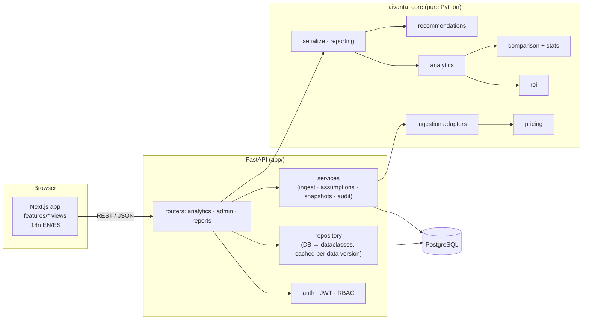

# Architecture

## Overview



## Principles

1. **Business logic is framework-free.** `backend/aivanta_core` uses only the Python standard library. It defines the domain (`domain.py`), and the engines take plain dataclasses in and return plain results out. This keeps every financial rule deterministic, unit-testable in milliseconds and reusable from the API, the seed script, CSV exports and offline notebooks.
2. **The web layer is thin.** `backend/app` authenticates, enforces permissions, scopes every query to the caller's organisation, loads the data and returns `aivanta_core.serialize` payloads. Routers contain no calculations.
3. **Language-neutral data, localised presentation.** Database values, API fields, enum values and error codes are English snake_case identifiers (`cost_avoidance`, `insufficient_evidence`, `invalid_filters`). The frontend translates them from `src/i18n/messages/{en,es}.json`; CSV reports use `aivanta_core/locales/{en,es}.json`.
4. **Evidence is a first-class attribute.** Every KPI payload carries a `basis` (`measured`, `evidence_backed`, `estimated`), and `null` always means "not available", never zero.

## Backend

| Module | Responsibility |
|---|---|
| `aivanta_core/domain.py` | dataclasses and enums: usage events, tasks, use cases, cost items, benefit claims, budgets, assumptions, dataset |
| `pricing.py` | versioned price schedule, per-event cost, cheaper-model lookup |
| `roi.py` | cost breakdown, benefit selection and de-duplication, hours saved, ROI, scenarios, break-even, payback |
| `stats.py` | means, Welch interval, proportion interval, z-scores (no NumPy) |
| `comparison.py` | AI vs. non-AI arms, task-type segments, the five-way decision |
| `analytics.py` | filters, usage totals, breakdowns, trends, adoption, anomalies, department and use-case scopes, budgets |
| `recommendations.py` | eight explainable rules, each returning the metrics that triggered it |
| `ingestion/` | canonical CSV, OpenAI, Anthropic and Gemini adapters; attribution map; deterministic event ids |
| `synthetic.py` | reproducible 90-day demo dataset |
| `reporting.py` | localised CSV exports |
| `serialize.py` | API payloads, filter parsing, assumption validation |
| `app/models.py` | SQLAlchemy 2 ORM (20 tables) |
| `app/repository.py` | loads an organisation into a `Dataset`; LRU cache keyed by `(organisation, data_version)` |
| `app/services.py` | ingestion pipeline, assumption updates, ROI snapshots, alert acknowledgement, audit events |
| `app/security.py` | PBKDF2 password hashing, JWT issue/verify, role → permission map |
| `app/api/*` | REST routers |

### Request flow (read)

1. `deps.current_principal` decodes the bearer token into `(user, organisation, role)`.
2. `deps.require("read")` checks the role's permissions.
3. `deps.org_dataset` loads **only the caller's organisation** (`repository.load_dataset`), served from cache unless `organizations.data_version` changed.
4. `deps.request_filters` parses and clamps query parameters.
5. The router returns a `serialize.*_payload(...)`.

### Write flow (ingestion)

`POST /api/ingestion/{format}` → size and encoding checks → adapter parse (whole-file errors → 422, row errors → rejected list) → attribution rules → pricing (unpriced → rejected) → de-duplication against existing `external_id`s → bulk insert with an `ingestion_batches` row → `data_version + 1` (invalidates the analytics cache) → audit event.

### Data model

```
organizations ─┬─ departments ─┬─ users (members + app accounts, role)
               │               └─ budgets
               ├─ use_cases ─┬─ experiments (study design)      ├─ tasks (AI / non-AI arms)
               │             ├─ baselines                        └─ benefit_claims
               ├─ usage_events ── ai_models ── ai_providers
               ├─ model_prices (versioned, per organisation)
               ├─ cost_items (allocated to use case / department / organisation)
               ├─ attribution_rules · ingestion_batches
               ├─ assumption_sets · roi_snapshots · alerts · audit_events
```

All tenant tables carry `organization_id` with `ON DELETE CASCADE`; business keys are unique per organisation. Check constraints guard enum columns, `cached_input_tokens <= input_tokens`, `request_count >= 1`, non-negative benefits and valid periods.

The DDL lives in `migrations/sql/0001_initial.sql` and is applied by Alembic revision `0001_initial`. `tests/api/test_migrations.py` diffs it against the ORM metadata so the two cannot drift.

### Roles

| Permission | admin | finance | analyst | viewer |
|---|---|---|---|---|
| read dashboards and reports | ✓ | ✓ | ✓ | ✓ |
| upload usage | ✓ | | ✓ | |
| edit assumptions | ✓ | ✓ | | |
| freeze ROI snapshots | ✓ | ✓ | | |
| read audit log | ✓ | | | |
| acknowledge alerts | ✓ | ✓ | ✓ | |

## Frontend

* **Next.js App Router**, every page a client component that renders a view from `src/features/`. Pages stay thin so views can be rendered and tested outside Next.
* **State:** `I18nProvider` (locale in `localStorage`, synced to the user profile), `AuthProvider` (token, current user, permissions), `FiltersProvider` (date range and dimension filters shared by all pages), and `useApi` for data fetching with loading, error and empty states.
* **Charts** (`components/charts.tsx`) are SVG built with `d3-scale`/`d3-shape`: time series with crosshair tooltip and anomaly markers, horizontal bars with drill-down, adoption columns, a cost-to-net-benefit bridge, a forest plot of confidence intervals and budget meters. Every chart has a table view. Colours use a validated colour-blind-safe categorical order; status colours always come with an icon and a label.
* **Formatting** (`lib/format.ts`) uses `Intl` with `en-GB` and `es-ES`; currency is the organisation's (EUR in the demo).

## Scaling notes

Analytics run in memory over the organisation's records. The demo (≈22k usage events, ≈19k tasks) loads in well under a second and is then cached. For production volumes the natural next step is daily roll-up tables (per organisation × day × department × use case × model) maintained at ingestion time, with `analytics.py` reading the roll-ups — the engines' inputs and outputs would not change.
